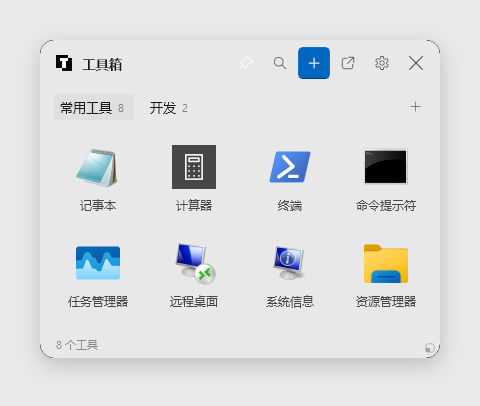
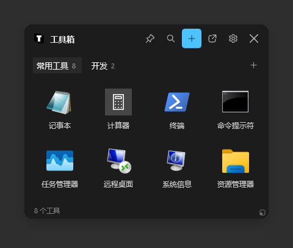
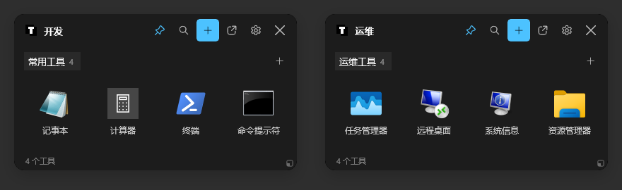
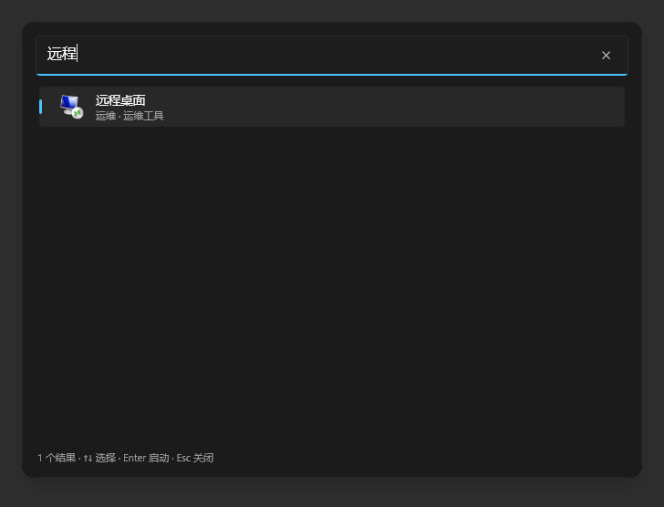
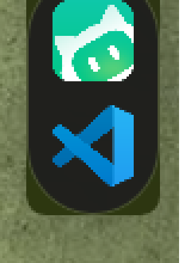
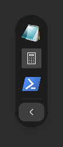
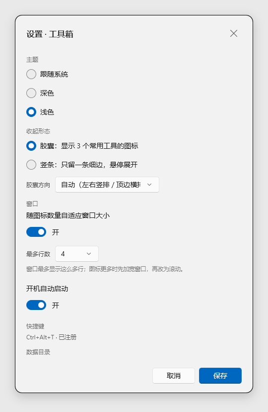
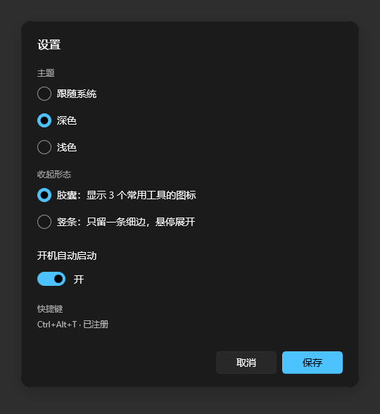

# TBox · 桌面工具箱

把散落在桌面上的小工具收进一个盒子：分组摆放、可搜、贴边收起、随叫随到。

Windows 10 / 11 · WinUI 3 · .NET 8 · v2.4.1 · 本地存储 · 无网络请求

| 浅色 | 深色 |
| --- | --- |
|  |  |

## 为什么做它

自己写的小工具、下载的便携 exe、批处理、系统管理面板……直接丢桌面，几十个图标之后桌面就没法看了；
放开始菜单又找不到；过几个月连"这个 exe 是干嘛的"都忘了。

TBox 只做一件事：**把这些快捷方式收进盒子，分类、可搜、随时取用**。它不搬动、不复制、不修改你的任何文件。

## 功能

- **拖进来就能用**：拖入 `.exe` `.lnk` `.bat` `.cmd` `.msc` `.url` 或文件夹，自动取图标和名称。
- **描述与关键字**：给每个工具写一句"它是干什么的"，加几个关键字；搜索同时匹配**名称 / 描述 / 关键字**，支持多词（`串口 modbus`）。
- **忠实启动**：保留快捷方式的参数与工作目录（便携工具能找到同级配置），支持「以管理员身份运行」。
- **失效提醒**：目标被删或改名后卡片出现红角标，状态栏汇总数量；右键「编辑路径」重新指向。
- **分组**：标签页分组，卡片可拖拽排序、移动到其它分组；支持从桌面批量导入。
- **多盒子（最多 4 个）**：每个盒子有独立的分组、面板、贴边位置、胶囊和自适应设置，可以一个放开发工具、一个放运维工具，分别贴在不同屏幕边缘；托盘菜单可切换/新建/重命名/删除盒子，面板标题显示盒子名。
- **自适应尺寸**：悬浮和贴边时窗口都按当前分组的图标数量收缩/扩展；超过设定行数会先加宽（最多 8 列），宽度用尽后再滚动。设置里可开关并限制最多行数。
- **贴边收起**：
  - 拖到屏幕左/右/上边缘 → 吸附，拖动时有强调色预览条；顶边保留拖动时的横向位置和宽度；
  - 收起为**胶囊**：默认显示当前分组前 3 个工具，**点图标直接启动**；右键卡片 →「胶囊」可固定最多 3 个工具，按分组内卡片顺序显示；方向可选：自动（左右竖排 / 顶边横排）、竖排、横排；
  - 展开区：竖排在底部、横排在右端；顶边面板向下滑出；
  - 或切换为**竖条**模式：只留一条细边，悬停展开；顶边是 16px 高的水平细条；
  - **钉住（📌）**：标题栏或托盘菜单钉住当前盒子后，鼠标移开也不自动收起，重启后保持展开；再点一次取消。
- **全局搜索**：`Ctrl+Shift+T` 或托盘菜单呼出，搜索所有盒子的名称/描述/关键字；结果标注所属盒子/分组，`↑`/`↓` 选择、`Enter` 启动、`Esc` 关闭。
- **原生观感**：DWM 抗锯齿圆角、亚克力背板、深浅色跟随系统（也可固定深/浅）。
- **高 DPI 清晰度**：图标按当前显示器的物理像素解码（44 DIP → 200% 下 88px），布局像素对齐，胶囊尺寸取整；2K/4K 下文字和图标边缘更干净。
- **对话框**：设置、输入、确认都是独立窗口；标题区可拖动，右上角 X 关闭。
- **常驻系统**：托盘图标、`Ctrl+Alt+T` 全局唤出、开机自启、单实例、不进 Alt+Tab。
- **纯本地**：数据就是一个可读的 JSON，随时备份/迁移/手改。

| 多盒子（开发 / 运维，两个盒子同时钉住） |
| --- |
|  |

| 全局搜索（Ctrl+Shift+T） |
| --- |
|  |

| 收起胶囊 | 设置 |
| --- | --- |
|   |   |

## v2.4.1 更新

- 修复贴边面板从 flyout / 隐藏到托盘状态返回后，`_mode` 未归位导致胶囊悬停展开、移开自动收起和 📌 图钉失效的问题。
- 胶囊固定角标改用系统 **Segoe UI Symbol** 的单色 💊 胶囊字形，右键「胶囊」菜单同款；不再使用图钉作为胶囊标记。

## v2.4.0 更新

- **胶囊自定义**：右键卡片 →「胶囊」固定/取消固定，每个分组最多 3 个；按分组卡片顺序显示，卡片带 📌 角标。
- **全局搜索**：`Ctrl+Shift+T` / 托盘菜单打开跨盒子搜索，标注来源，支持键盘选择和 Enter 启动。
- **数据可靠性**：保存失败保留 dirty 并 2 秒重试；退出时记录最终保存错误。
- **启动与 Shell**：可等待的异步启动；Win32 API 失败写入日志；Explorer 重启后自动恢复托盘图标；开机启动写入失败会提示。

## v2.3.0 更新

- **多盒子**：同一个进程最多 4 个盒子，每个盒子有独立的分组、工具、面板、贴边位置、胶囊和自适应设置；托盘菜单切换/新建/重命名/删除，标题栏显示盒子名。
- **钉住与收起**：📌 钉住后不自动收；方块箭头隐藏到托盘并保留贴边；X 收起（贴边变胶囊，未贴边到托盘）。
- **贴边体验**：贴边盒子从托盘/热键唤回后仍在边缘展开并自动收胶囊；未贴边面板记住隐藏前的位置；外部拖文件时不会先收起。
- **显示**：图标按物理像素解码、布局像素对齐、滑动动画按 60Hz 节奏；对话框可拖动并带右上角 X。
- **分组**：右键标签重命名/删除；删除有确认，至少保留一个分组。

## 快速开始

### 两种发行包

| 包 | 大小 | 需要 |
| --- | --- | --- |
| `TBox-<版本>-lite-win-x64.zip` | 约 10MB | [.NET 8 Desktop Runtime](https://dotnet.microsoft.com/download/dotnet/8.0) + Windows App Runtime 1.7 |
| `TBox-<版本>-full-win-x64.zip` | 约 100MB | 不需要装 .NET；内含 Windows App Runtime 安装器和 `install-and-run.cmd` |

轻量包适合已经装了 .NET / Windows App Runtime 的机器；完整包适合直接拷到干净机器，
双击 `install-and-run.cmd` 即可。CI 每次构建都会同时产出两个 zip。

### 直接运行

解压后运行：

```powershell
.\TBox.exe
```

轻量包需要：

- [.NET 8 Desktop Runtime](https://dotnet.microsoft.com/download/dotnet/8.0)（装了 .NET 8 SDK 就已包含）
- Windows App Runtime 1.7（大多数装了商店应用的机器已有；没有时运行会提示）

完整包自带 .NET 运行时，只需要 Windows App Runtime；安装器已在包内，运行 `install-and-run.cmd` 会处理。

### 从源码构建

```powershell
dotnet build src\TBox.WinUI\TBox.WinUI.csproj -c Debug -p:Platform=x64
.\src\TBox.WinUI\bin\x64\Debug\net8.0-windows10.0.19041.0\TBox.exe
```

### 发布

```powershell
# 轻量包：框架依赖 .NET，约 10MB
dotnet publish src\TBox.WinUI\TBox.WinUI.csproj -c Release -r win-x64 `
    --self-contained false -p:Platform=x64 -o dist-lite

# 完整包：.NET 自包含，约 100MB
dotnet publish src\TBox.WinUI\TBox.WinUI.csproj -c Release -r win-x64 `
    --self-contained true -p:Platform=x64 -o dist-full
```

完整包还需要把 `WindowsAppRuntimeInstall-x64.exe` 和 `scripts/install-and-run.cmd` 放进
`dist-full`；CI 会自动完成这一步并把两个目录分别压成 zip。产物是绿色目录，整体复制即可分发。

> **构建说明**：本机没有 Visual Studio 的 UWP/MSIX 打包工具链，项目里用
> `Directory.Build.targets` 把 VS 私有构建目标替换成 `makepri` 手工生成 `resources.pri`。
> 装好 VS「Windows 应用开发」工作负载后可以删掉该文件，恢复标准 WinUI 构建链。详见技术文档。

## 使用

1. **添加**：把快捷方式拖进窗口；或点标题栏 `＋` →「添加文件…」；或「从桌面导入…」批量勾选。
2. **启动**：双击卡片；或选中后按 `Enter`；胶囊里点图标。
3. **管理**：右键卡片 → 打开 / 以管理员身份运行 / 打开文件所在位置 / 重命名 / 编辑描述关键字 / 编辑路径 / 移动到分组 / 从盒子移除；其中「胶囊」子菜单可固定/取消固定到胶囊（最多 3 个）。右键分组标签 → 重命名分组 / 删除分组（至少保留一个）。
4. **搜索**：面板内点放大镜或 `Ctrl+F` 搜索当前分组；跨盒子用 `Ctrl+Shift+T` 或托盘菜单「全局搜索…」，显示所属盒子和分组，`↑`/`↓` 选择、`Enter` 启动、`Esc` 关闭。
5. **贴边**：拖着标题栏往屏幕左/右/上边缘靠，出现强调色预览后松手；面板会自动收起。胶囊方向可选自动（左右竖排 / 顶边横排）、竖排、横排。
6. **多盒子**：右键托盘图标 →「新建盒子…」；菜单顶部列出所有盒子，点击即可切换。每个盒子有自己的分组、贴边/胶囊和自适应设置；最多 4 个，满后新建置灰。关闭面板不会删除盒子。
7. **钉住**：点标题栏的 📌 或托盘菜单「当前盒子钉住」，面板就不再自动收起；再点一次恢复自动收起。钉住状态按盒子保存，重启后仍展开。
8. **隐藏/退出**：标题栏方块箭头 = **隐藏到托盘**（保留贴边状态，一次点击生效）；X = **收起**（贴边时收成胶囊，未贴边时隐藏到托盘）。要从桌面层取消贴边，用托盘右键菜单的「当前盒子放回桌面」。从托盘左键或 `Ctrl+Alt+T` 唤回：贴边盒子在贴边处展开、移开鼠标后自动收成胶囊；未贴边的回到上次位置。退出请用托盘菜单。

> 从 v2.2 及更早版本升级时，原来的分组和窗口/贴边设置会自动迁移成一个「工具箱」盒子，旧数据保留在
> `data.bak.json`；再通过托盘菜单新建其它盒子即可。

### 命令行参数

| 参数 | 作用 |
| --- | --- |
| `--dock-right` | 启动即吸附到右边缘 |
| `--dock-top` | 启动即吸附到上边缘（自动横排胶囊） |
| `--flyout` | 启动即从右下角弹出 |
| `--settings` | 启动后打开设置 |

### 快捷键

| 快捷键 | 作用 |
| --- | --- |
| `Ctrl + Alt + T` | 全局显示/隐藏面板 |
| `Ctrl + Shift + T` | 全局搜索所有盒子 |
| `Ctrl + F` | 展开当前面板搜索 |
| `Enter` | 启动选中项 |
| `Esc` | 收起搜索 / 隐藏面板 |

### 数据位置

```
%APPDATA%\TBox\
├─ data.json          分组、工具、设置（UTF-8，可手改）
├─ data.bak.json      上一次保存的备份
├─ icons\             图标缓存
└─ error.log          异常日志（如有）
```

用 `TBOX_DATA` 环境变量可指定其它目录，做成便携版：

```powershell
$env:TBOX_DATA = "D:\Tools\TBoxData"; .\TBox.exe
```

## 项目结构

```
TBox\
├─ docs\
│  ├─ PRD.md                产品需求文档
│  ├─ TECH.md               技术方案、关键实现与踩坑记录
│  ├─ RESEARCH-MULTI-BOX.md 多盒子/多胶囊预研
│  ├─ ANALYSIS-PROJECT-HEALTH.md 外部健康度审查（归档）
│  ├─ ITERATION-PLAN.md     优化顺序与迭代计划
│  ├─ logo\                 图标原图与生成产物
│  └─ images\               截图
├─ src\TBox.WinUI\          应用主体（WinUI 3）
│  ├─ BoxManager.cs         盒子生命周期 / 活动盒子 / 托盘菜单
│  ├─ DockPoll.cs           所有盒子共用的停靠轮询
│  ├─ MainWindow.xaml       单个盒子的面板 UI
│  ├─ MainWindow.Docking.cs 贴边 / 胶囊 / 竖条状态机
│  ├─ MainWindow.AutoFit.cs 按图标数量自适应窗口尺寸
│  ├─ CapsuleWindow.cs      胶囊窗口
│  ├─ Views\DialogWindow.cs 通用对话框窗口
│  ├─ Views\GlobalSearchWindow.cs 跨盒子搜索面板
│  ├─ Models\ Services\ Interop\
│  └─ Assets\               应用图标
├─ scripts\
│  ├─ make_icon.py          生成应用图标
│  ├─ screenshot.ps1        窗口截图
│  ├─ capture-tbox.ps1      按进程抓窗口（含子窗口）
│  └─ compose-screenshot.py 截图圆角/阴影/背景合成
├─ dist-lite\ / dist-full\  轻量 / 完整发布产物
```

## 已知限制

- 独占全屏程序（全屏游戏）会盖住置顶窗口；
- 绿色分发，没有系统级安装/自动更新；
- 胶囊默认显示当前分组前 3 个工具；可固定最多 3 个并随卡片顺序调整，但暂不支持独立的胶囊拖拽排序；
- 「跟随系统」主题在启动时读取，运行中切换系统主题需重启；主题是全局的，不能每个盒子不同；
- 分组暂不支持拖拽排序；
- 多盒子最多 4 个；所有盒子的面板窗口启动时都会创建（未贴边/隐藏的也占内存）；同边多个盒子的胶囊没有自动堆叠，跨盒子拖拽工具未实现。方案和实测见[多盒子文档](docs/RESEARCH-MULTI-BOX.md)。

## 文档

- [产品需求文档（PRD）](docs/PRD.md)
- [技术方案](docs/TECH.md)
- [多盒子设计与实测](docs/RESEARCH-MULTI-BOX.md)
- [项目健康度分析（归档）](docs/ANALYSIS-PROJECT-HEALTH.md)
- [优化顺序与迭代计划](docs/ITERATION-PLAN.md)
- [Logo 资产存档](docs/logo/README.md)
